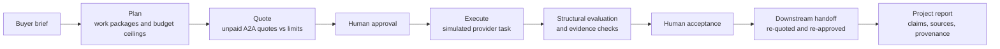
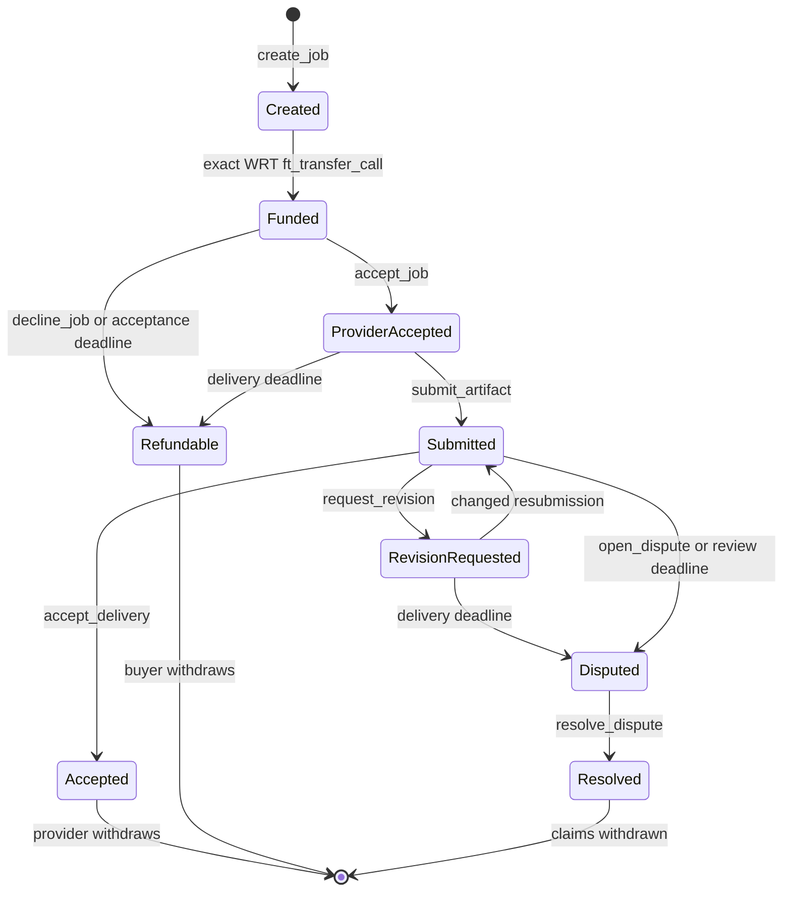

# WorkRelay

**An evidence-backed research procurement workflow for the NEAR Agent Economy: it turns one narrow buyer decision into scoped work packages, compares unpaid provider quotes, hands accepted work downstream only with hash-bound human approval, and shows the claim and source evidence a reviewer can inspect. A separate NEAR testnet escrow is an optional settlement proof, not payment to an Agent Market provider.**

<p align="center">
  
</p>

**Docs: [guides](#-docs-)** · **Escrow spec: [NEAR_TESTNET_ESCROW_SPEC.md](docs/NEAR_TESTNET_ESCROW_SPEC.md)** · **Testnet runbook: [NEAR_TESTNET_DEPLOYMENT_RUNBOOK.md](docs/NEAR_TESTNET_DEPLOYMENT_RUNBOOK.md)**


## ⭐ Overview ⭐

**The problem.** Buying research from an AI agent marketplace is easy to start and hard to trust. A listing is untrusted input, a quote is not a price you approved, a delivery is not an accepted result, and an accepted result is not a verified claim. Most tools blur these steps. WorkRelay keeps each one separate and shows the evidence behind the final answer.

**What this is.** A single Node.js app with no runtime dependencies. It plans a decision into work packages with budget ceilings, requests unpaid A2A quotes from NEAR Agent Market providers, and compares them against package and project limits. Each stage needs an explicit human step before the next one starts. Results are presented as material claims with supporting and contradicting sources, dates, calculations and provenance.

**The idea.** Every transition is a separate decision, and no stage implies the next:

> Quote retrieval is not approval. Approval is not commissioning. Commissioning is not delivery. Delivery is not acceptance. Acceptance is not payment settlement.

A dependent package receives upstream content only after the upstream package has a matching content hash, passed structural evaluation and received explicit human acceptance, and the downstream request is quoted again.


## 🧭 What works today 🧭

WorkRelay is a hackathon MVP with four deliberately distinct capabilities. The table says plainly what each one is and is not.

| Capability | Status | What it is **not** |
| --- | --- | --- |
| **Simulation** | ✅ Working. No wallet, account, chain call or real funds. Four scenario branches. | Not live research and not real provider work. Every provider, price and deliverable is labelled `SIMULATED`. |
| **Live discovery and quote inspection** | ✅ Working. Public Agent Market discovery and unpaid A2A quote requests. | A quote is not an approval, a commission or a payment. Nothing is signed or spent. |
| **NEAR testnet escrow proof** | 🟡 Source complete. Format, Clippy (`-D warnings`), unit tests, integration-crate Clippy and WASM build pass on Rust 1.97.0. **The 6 NEAR Sandbox integration tests have not been run yet.** Not deployed yet. | Not audited. Testnet only (rejects mainnet). Uses the WRT test token, which has no monetary value. Not connected to Agent Market commissioning. |
| **Live Agent Market payment** | ⛔ Out of scope and disabled. No wallet signer is bundled. | The app-server accepts EVM buyer networks (Base, Polygon, Arbitrum) while the current Agent Market hiring guide documents a NEAR-mainnet profile. These flows are unreconciled, so keep payment disabled. See [payment safety](docs/X402_PAYMENT_AUTHORIZATION.md). |

The Node suite passes **228/228** and the inactive publisher-candidate pack validates (9 exact-host candidates, all inactive). Node tests and host or WASM compilation do **not** establish on-chain state-machine behaviour. That needs the Sandbox gate below.


## 🏃 Quick Start for judges 🏃

| 🧪 Simulation · 1 min | ✅ Verify · 2 min | ⛓️ Contracts · WSL2 |
| --- | --- | --- |
| `npm start`<br>Open **[http://localhost:4173](http://localhost:4173)** | `npm test`<br>`npm run validate:publisher-candidates` | `npm run format:near-contracts`<br>`npm run check:near-host`<br>`npm run test:near-contracts` |
| The full no-wallet journey: plan, quote, execute, evaluate, accept, then a freshly quoted downstream package, ending in a downloadable project report | The whole Node suite, then the inactive Nigeria fintech candidate pack is checked. It does not activate or trust any publisher domain | Formats the Rust sources once, runs the read-only format, Clippy and unit gate, then builds WASM and runs the Sandbox tests |
| Node.js >= 20. Nothing to install: there are no runtime dependencies | Node.js >= 20 | Rust 1.97.0 with the `wasm32-unknown-unknown` target. On Windows, use WSL2 Ubuntu, not Git Bash |
| You see the `SIMULATED` labels and the four scenario controls | Ends with `# pass 228`, `# fail 0` and `Validated 9 exact-host candidates` | Ends with all 6 Sandbox integration tests passing, then the Node suite again |

The server listens on port `4173`. Set `PORT` to change it.

<details>
<summary><b>Rust toolchain notes</b></summary>

- `rust-toolchain.toml` pins `1.97.0` and the workspace declares `1.95` as its minimum. The WASM target is not auto-requested, so host gates run without it. Add it for the WASM and Sandbox gates with `rustup target add wasm32-unknown-unknown`.
- `check:near-host` is **read-only**: `cargo fmt --check`, Clippy with warnings denied and both contract unit-test suites. Run `format:near-contracts` once when you change Rust sources. It also refreshes `SHA256SUMS.txt`.
- `test:near-contracts` runs the host gate, builds WASM, lints the integration-test crate with `-D warnings`, runs the Sandbox tests single-threaded, then re-runs `npm test` and the candidate validator. It never deploys.
- If `rustup` cannot download the pin but your installed `stable` is also `1.97.0`, `export RUSTUP_TOOLCHAIN=stable` for the session.
- Commit `Cargo.lock`. The scripts build with `--locked`.

</details>


## ✨ Features ✨

| Feature | What it does |
| --- | --- |
| **Scoped planning** | Splits a buyer decision into draft work packages with budget **ceilings**. A ceiling is not a provider price. |
| **Unpaid quote comparison** | Reads public Agent Market listings, requests unpaid A2A quotes, and validates each against package and project limits. Listings and quotes are treated as untrusted input. |
| **Evidence-backed review** | Material claims carry supporting and contradicting sources, dates, calculations, uncertainty and provenance. Publisher authority, freshness, copied-source signals and conflicts feed a packet-bound human review. |
| **Hash-bound handoff** | Upstream artifacts reach a dependent package only after a matching content hash, structural evaluation and explicit human acceptance. The downstream request is quoted and approved again. |
| **No-wallet sandbox** | Four judge-visible branches: success with human acceptance, revision request, refund before submission, and an unresolved dispute. Reset and replay are supported. |
| **Demo credits** | Simulated access limits, not money or a wallet balance. They are abuse friction, not strong identity or rate limiting. |
| **NEAR testnet escrow** | Hash-committed terms, pull-based claims, private callbacks that restore the exact claim when a transfer fails, permanent job-ID tombstones, and an accounting invariant exposed as a view. |
| **Guarded deploy tooling** | `deploy-near-testnet.sh` accepts only `.testnet` accounts, hard-codes the testnet network and requires typing `DEPLOY-TESTNET` before signing. |


## 🗺️ How it works 🗺️



| Path | What it holds |
| --- | --- |
| `src/app-server.js`, `public/` | The HTTP server (`/api/plan`, `/api/quote`, `/api/execute`, `/api/evaluate`, `/api/review`, `/api/demo/*`, `/api/health`) and the browser app |
| `src/contractor/`, `src/market/`, `src/procurement/` | Work-package planning and provider matching, Agent Market discovery and A2A quotes, quote validation and recipient review |
| `src/orchestration/` | Project lifecycle, simulated execution, structural evaluation, dependency handoff and the provenance report |
| `src/evidence/` | The evidence pipeline and the evidence-quality policy engine |
| `src/contracts/`, `src/storage/`, `src/security/`, `src/demo/` | Versioned schemas with canonical serialization, private file-backed stores, principals and the demo-credit ledger |
| `src/payments/`, `src/near-intents/` | x402 authorization guards (disabled by default) and an isolated NEAR Intents client that is **not** wired up as a signer |
| `contracts/` | `job-escrow`, `workrelay-test-token` (WRT) and the Sandbox `integration-tests`, plus a shared cross-language test vector |
| `config/`, `scripts/`, `test/` | The inactive publisher candidate pack, CLI and contract tooling, and the Node test suite |


## ⛓️ NEAR testnet escrow ⛓️

A separate Rust workspace holds the optional settlement proof:

- **`contracts/job-escrow`**: one buyer, one assigned NEAR-account provider, one named resolver, one immutable allowlisted token, and immutable hash-committed terms per job.
- **`contracts/workrelay-test-token`**: WRT, a WorkRelay-controlled NEP-141 / NEP-145 / NEP-148 token fixed at six decimals and labelled as having no monetary value.
- **`contracts/integration-tests`**: 6 Sandbox tests that deploy the compiled WASM and exercise roles, deposits, state transitions, deadlines, failed withdrawals and accounting.



Silence never moves money: expired review or revision deadlines enter an unresolved dispute with no default payout or refund. Only the named resolver can allocate a dispute, and the allocation must sum exactly to the escrowed amount. See the [method reference](docs/NEAR_ESCROW_METHODS.md) and the [full specification](docs/NEAR_TESTNET_ESCROW_SPEC.md).


## 🧰 CLI commands 🧰

All of these are read-only with respect to marketplace spending. None of them signs, commissions or pays a provider.

```bash
npm run discover -- research
npm run rank -- "market research competitor analysis"
npm run plan  -- 10 "Research the Kenyan fintech market, identify five competitors, analyse their positioning and produce a market-entry report"
npm run quote -- 10 "Research the Kenyan fintech market, identify five competitors, analyse their positioning and produce a market-entry report"
npm run probe -- cited-research-desk "Return the price quote only; do not begin paid work."
```

`plan` creates draft work packages and budget ceilings. `quote` requests unpaid provider quotes and compares them with package and project limits. `probe` inspects one provider's Agent Card and unpaid A2A response.


## 🚀 Deploy 🚀

**Simulation-only demo.** Deploy as a **single Node.js process** with HTTPS, persistent private storage and a strong `DEMO_CREDIT_IP_SECRET`. Do not configure a wallet adapter or live network allowlists. The JSON stores are single-process only: no multiple instances, serverless replicas or horizontally scaled workers.

```bash
export NODE_ENV=production PORT=4173 TRUST_PROXY=false
export DEMO_CREDIT_IP_SECRET='<random, 32+ characters, kept stable across restarts>'
npm start
```

The app reads `process.env` directly and does **not** load a `.env` file, so set these in your shell or your platform's secret manager. [`.env.example`](.env.example) lists every variable. Leave all `X402_*` variables empty. See the [deployment guide](docs/DEPLOYMENT.md) for proxy, storage and verification requirements.

**Testnet escrow proof.** Use five separate `.testnet` accounts (buyer, provider, resolver, WRT contract, escrow contract), then follow the [runbook](docs/NEAR_TESTNET_DEPLOYMENT_RUNBOOK.md):

```bash
npm run test:near-contracts      # preferred gate before any deployment
npm run deploy:near-testnet      # guarded; requires typing DEPLOY-TESTNET
```

Until the Sandbox gate passes, a testnet deployment is a **provisional smoke test** on disposable accounts with WRT only. It is not local contract acceptance and not an audit. Say only what you demonstrated.


## 📚 Docs 📚

| Guide | Covers |
| --- | --- |
| [Deployment](docs/DEPLOYMENT.md) | Safe single-instance demo deployment and preflight |
| [Demo credits](docs/DEMO_CREDITS.md) | Limits, reservation accounting and privacy |
| [Quote and procurement](docs/QUOTE_AND_PROCUREMENT.md) | Discovery, provider matching, quote validation and dependency handoff |
| [Execution orchestration](docs/EXECUTION_ORCHESTRATION.md) | Commissioning state, task tracking, artifact evaluation and acceptance |
| [Sandbox and handoff](docs/SANDBOX_AND_HANDOFF.md) | Hash-bound dependencies, fresh downstream boundaries and replayable branches |
| [Schema contracts](docs/SCHEMA_CONTRACTS.md) | Versioned records, canonical serialization and SHA-256 commitments |
| [Evidence pipeline](docs/EVIDENCE_PIPELINE.md) | Safe source capture, committed evidence packets and typed deterministic checks |
| [Evidence quality policy](docs/EVIDENCE_QUALITY_POLICY.md) | Publisher authority, freshness, provenance, conflicts and packet-bound human review |
| [Evidence freshness calibration](docs/EVIDENCE_FRESHNESS_CALIBRATION.md) | Cadence rationale, operating tolerances and regulatory currentness |
| [Publisher registry research](docs/PUBLISHER_REGISTRY_RESEARCH_NIGERIA_FINTECH.md) | Inactive Nigeria fintech exact-host candidates and promotion requirements |
| [Publisher registry owner review](docs/PUBLISHER_REGISTRY_OWNER_REVIEW.md) | Pending deployment-owner review; no candidate is activated |
| [x402 payment authorization](docs/X402_PAYMENT_AUTHORIZATION.md) | Protocol mismatch, signer boundary and live-spending blockers |
| [Hackathon scope reset](docs/HACKATHON_SCOPE_RESET.md) | The frozen evidence baseline, three product modes and implementation order |
| [Escrow specification](docs/NEAR_TESTNET_ESCROW_SPEC.md) | State machine, roles, storage, liabilities and integration-test requirements |
| [Escrow method reference](docs/NEAR_ESCROW_METHODS.md) | Terms fields, every method, its caller and behaviour |
| [Testnet deployment runbook](docs/NEAR_TESTNET_DEPLOYMENT_RUNBOOK.md) | Accounts, deployment, on-chain verification and the optional one-WRT smoke test |
| [Browser QA report](docs/BROWSER_QA_REPORT.md) | Step 6 simulation journey, branches, keyboard and 390px layout checks |
| [Windows notes](docs/WINDOWS_DEVELOPMENT.md) | PowerShell usage and NTFS permission handling for the private stores |


## 📜 Disclaimer & License 📜

For research and education only. WorkRelay is not a custody service, a production payment processor, a guarantee of provider performance, investment advice or legal advice.

- **Untrusted by design.** Provider listings and quotes are external input. Work-package budgets are ceilings, and the actual quote is evaluated separately. A testnet transaction does not prove mainnet safety, audited correctness, research truth or payment readiness.
- **Built with AI assistance.** The code and documentation were produced with AI assistance. Correctness claims in this README are limited to the test and build gates it names.
- **No dependencies at runtime.** `package.json` declares none. The contracts use `near-sdk` and `near-workspaces` with versions locked in `Cargo.toml` and `Cargo.lock`.
- **License.** This is a private MVP (`package.json` sets `private: true`) and no open-source license is granted.

<p align="center">
  
</p>
